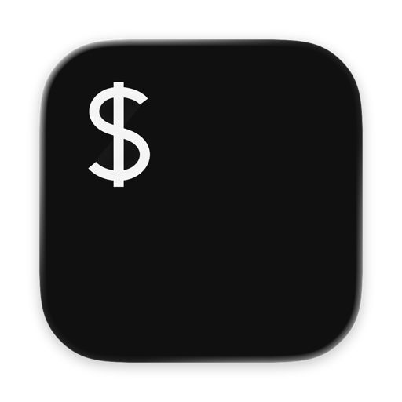

# Therm2

[](https://github.com/trufae/therm2/actions/workflows/ci.yml)



A small native macOS terminal built with AppKit and [SwiftTerm](https://github.com/migueldeicaza/SwiftTerm).
Therm's essentials, starting from an empty codebase: tabs, nested splits, instant fullscreen,
an opaque dark background, and little else. The icon is a dark terminal with a simple
prompt, authored as vector artwork in an Icon Composer document. macOS supplies the
icon shape and corners; there is no extra tile, silver bezel, or custom Dock view.

## Build

Requires macOS 13 or newer and Swift 6.2 or newer (Xcode 26+).

```sh
make          # optimized, ad-hoc signed build/Therm2.app
make run
make test
make dmg      # universal release app + DMG and SHA-256 checksum in build/
```

Use `make debug` for a debug app bundle, then attach Xcode or LLDB to the running app.
The first build downloads dependencies. `Package.resolved` pins the complete resolution.
To install, copy `build/Therm2.app` to `/Applications`. Distribution builds need your own
Developer ID signature and notarization.

## Downloads and releases

[GitHub Releases](https://github.com/trufae/therm2/releases) provides versioned DMGs.
The [continuous prerelease](https://github.com/trufae/therm2/releases/tag/continuous)
tracks the latest successful build of `main`. Open the DMG and drag Therm2 to
Applications. These builds support Intel and Apple Silicon on macOS 13 or newer;
they are ad-hoc signed and are not notarized by Apple.

```sh
./version.sh         # print the app version from Resources/Info.plist
./version.sh 0.2.0   # set X.Y.Z and increment CFBundleVersion
make dmg            # build/Therm2-0.2.0-universal.dmg and .dmg.sha256
```

Setting the current version again leaves the build number unchanged. Commit the
version change, then push a matching tag (for example, `v0.2.0`) to publish a
versioned GitHub Release. CI rejects tags that disagree with `./version.sh`.
Every branch push, pull request, and manual CI run tests the app and runs
`make dmg`, keeping the DMG and checksum as downloadable Actions artifacts for
30 days. Successful `main` builds also update the continuous prerelease; version
tags publish the same tested artifacts as a release. Publishing uses the built-in
`GITHUB_TOKEN`; no additional release secret is needed.

## Icon artwork

The vector source is [`Resources/AppIcon.icon/Assets/prompt.svg`](Resources/AppIcon.icon/Assets/prompt.svg).
The Icon Composer document's `icon.json` supplies the background and styling. Edit the
SVG to change the prompt artwork; the normal app build uses the same icon exports.

```sh
make icons
# Or use another SVG and output directory:
./scripts/generate-icons.sh path/to/prompt.svg build/custom-icons
```

The script requires macOS and Xcode. It creates the Icon Composer document, a full-size
`AppIcon.icns`, `Assets.car`, an `.iconset`, and all ten macOS PNG entries (16–1024 pixels,
including Retina sizes) in `Assets.xcassets/AppIcon.appiconset`. Output defaults to
`build/icons`; the source artwork is left untouched. The exported PNGs include the
background and system-rendered icon shape, matching the compiled icon.

`make` and `make run` reuse these exports when the icon sources are unchanged and
regenerate them automatically after an SVG or styling edit. Each build replaces only
the app bundle so macOS notices the updated icon, while keeping SwiftPM's compiled
files. `make clean` is unnecessary for icon changes.

## Keys

| Shortcut | Action |
| --- | --- |
| ⌘N / ⌘T | New window / tab |
| ⌘, | Preferences |
| ⌘D / ⇧⌘D | Split left–right / top–bottom |
| ⌘W / ⇧⌘W / ⌥⌘W | Close pane / tab / window |
| ⌘1…9 | Select tab |
| ⇧⌘[ / ⇧⌘] | Previous / next tab |
| ⌘J / ⌘K | Previous / next pane within the current tab |
| ⇧⌘H / J / K / L | Move nearest divider left / down / up / right |
| ⌘Enter | Instant fullscreen |
| ⇧⌘Enter | Maximize current pane / restore splits |
| ⇧⌘G | Toggle Ignore Notch in Fullscreen |
| ⇧⌘F | Toggle Always on Top |
| ⌘+ / ⌘− / ⌘0 | Increase / decrease / reset active pane's font |
| ⌘F | Find in active terminal |
| ⌘C / ⌘V | Copy selection / paste |

Focus follows the mouse between panes in the active window. Inactive text is dimmed
by 30% initially; terminal backgrounds keep their colors, with pure black as the default.
The active pane stays at full brightness. Drag the thin dividers to
resize. With multiple tabs, a 14-point-high bar sits at the bottom of the window.
Tabs divide the full width equally, without scrolling. Labels start empty and combine
all nonempty terminal titles in their tab, separated by ` · `. Programs and shells can
set these titles with OSC 0 or OSC 2; the window title follows the focused terminal.

```sh
printf '\033]2;build\007'  # set this terminal's title
printf '\033]2;\007'       # clear it
```

Closing a shell closes its pane;
closing the last pane closes its tab. The application stays available in the Dock after
its last window closes. Closing a pane, window, or the app terminates its sessions without
a confirmation dialog.

Option uses the native keyboard layout, including Spanish ⌥º for `\`, ⌥3 for `#`, and dead-key accents.
It is not mapped to Meta; use Escape followed by a key for terminal Meta combinations.
Pinch over a pane to change its font size. Pinch and ⌘+/⌘− share the same 4–1024 point
range; ⌘0 restores the default size from Preferences (initially 13 points), and ⌘= also increases the size. Pinch travel accumulates
smoothly, with glyph caches rebuilt only when the size crosses a whole-point step.
Holding a key repeats it using the system repeat rate and delay; the app disables the
macOS press-and-hold accent picker, while dead-key composition remains available.

Maximizing a pane fills the current tab without restarting any session. A small outlined
square in its upper-right corner marks the maximized state. Toggling back
restores its split positions. ⌘J/⌘K cycle through panes while keeping them maximized;
splitting restores the layout. Other tabs keep their own layout and maximize state.

Trackpad scrolling works on both axes in mouse-aware terminal applications. Horizontal
swipes generate xterm wheel-left/right reports. In alternate-screen applications with
Alternate Scroll Mode enabled, they generate left/right cursor keys instead. Holding
Option or Shift retains SwiftTerm's local-scrolling bypass. The normal shell screen wraps
at the terminal width, so it has vertical scrollback rather than a horizontal viewport.

The pinned SwiftTerm release ignores horizontal wheel deltas and lacks foreground-only
dimming. `make`, `make debug`, and `make test` automatically apply the dependency patches
for [horizontal scrolling](patches/swiftterm-horizontal-scroll.patch) and
[foreground brightness](patches/swiftterm-foreground-brightness.patch)
after resolution. The preparation is idempotent and fails on an unexpected upstream
revision or conflicting edits. Use these build targets; a raw `swift build` after a fresh
checkout does not apply the patches. `make prepare` applies them without building the app.

Fullscreen reuses the current window, covers its current display, and auto-hides the Dock
and menu bar. It does not create a Space or animate. Leaving fullscreen restores the previous
window frame. The menu bar/notch strip has a black backing in fullscreen, and the revealed
menu bar uses an opaque background. The notch guard is enabled initially. View → Ignore Notch in Fullscreen
removes the top inset so terminal content reaches the very top of the display, including
the area around the camera. This shares its saved setting with Preferences.
Always on Top raises the window above normal application windows and persists across
fullscreen toggles. Toggle it again to return to normal window ordering.

## Preferences

⌘, opens a small native panel for terminal background, split separator color, font family and default size,
inactive text dimming (0–75%), the starting directory of new tabs and splits, ignoring
the fullscreen notch, and using an empty window title. Changes apply immediately to all
windows and are saved automatically. Font family changes preserve each pane's point size;
changing the default size applies it to existing panes, new panes, and ⌘0.
A compact preview shows the default font size, background, separator, and inactive text dimming.
An empty window title does not hide the ANSI-set names in the tab bar.

The app bundles the same five font files as Therm: Agave, ProggySquareTT, PxPlus IBM MDA,
DS-Digital, and PowerlineSymbols, plus IBM Plex Mono (Regular and Bold). They are registered only for this process; nothing is
installed in the user's or system's font directories. The original embedded notices are
preserved and collected in `Resources/Fonts/NOTICES.txt`. System font families remain
available as well. Restore Defaults returns to the original colors and System Monospace.

New tabs and splits inherit the active shell's directory by default. A single native
`proc_pidinfo` lookup reads the shell PID's working directory when creating a session;
there is no polling or extra shell command. If unavailable, the last local OSC 7 directory
is used, then Home. Choose Home directory in Preferences to always start there. New
windows start in Home. A program changing its own directory does not change its parent
shell's working directory.

## Small by design

- One SwiftTerm view and PTY per pane. The `NSSplitView` hierarchy is the split tree;
  there is no parallel layout model, output copy, polling timer, or web renderer.
- Inactive tabs are detached from the window. Their processes keep running and parsing
  output, while SwiftTerm suspends rendering for invisible views.
- 1,000 scrollback lines per pane, a steady cursor, and no blur, transparency, or animation.
  Kitty graphics are disabled and Sixel is not advertised; OSC payloads are limited to 1 MiB. Scrollback is bounded
  by lines, not a fixed byte budget.
- Core Graphics is the default renderer to avoid a GPU surface and glyph atlas per pane.
  To try SwiftTerm's Metal renderer, launch the executable with `THERM2_METAL=1`:

  ```sh
  THERM2_METAL=1 build/Therm2.app/Contents/MacOS/Therm2
  ```

  Metal falls back to Core Graphics if initialization fails. Compare both with your
  workloads; no claim of superior throughput or memory usage is made without measurements.
- SwiftTerm is the only direct package dependency. Portable graphics traits are disabled.
  SwiftPM may resolve upstream development dependencies, but they are not linked into the app.
- Login shells use the account's configured shell and inherit the launch environment.
- No telemetry, update checks, session restoration, profiles, or background services.

`make test` checks nested split insertion/collapse, view release, focus cycling, minimum
sizes, divider limits, title sanitation, and local directory handling. It also feeds real
AppKit wheel events through SwiftTerm and checks horizontal/vertical mouse reports,
cursor-key fallback, fractional travel, gesture boundaries, modifiers, and scrollback.
Mouse focus, text-field focus preservation, and accumulated pinch zoom are covered too.
Renderer checks cover foreground-only dimming, unchanged ANSI backgrounds and selection
highlights, and restoring colors when focus changes.
Preferences persistence and bundled font registration are covered. A real PTY test checks
directory inheritance without OSC 7, matching kernel window size, and SIGWINCH delivery
when a pane is split.
Rendering throughput and resident memory still need profiling on representative workloads
and displays.

## License

GPL-2.0-or-later; see [COPYING](COPYING). The icon is reused from
[Therm](https://github.com/trufae/Therm). SwiftTerm is MIT licensed and retains its own license.
